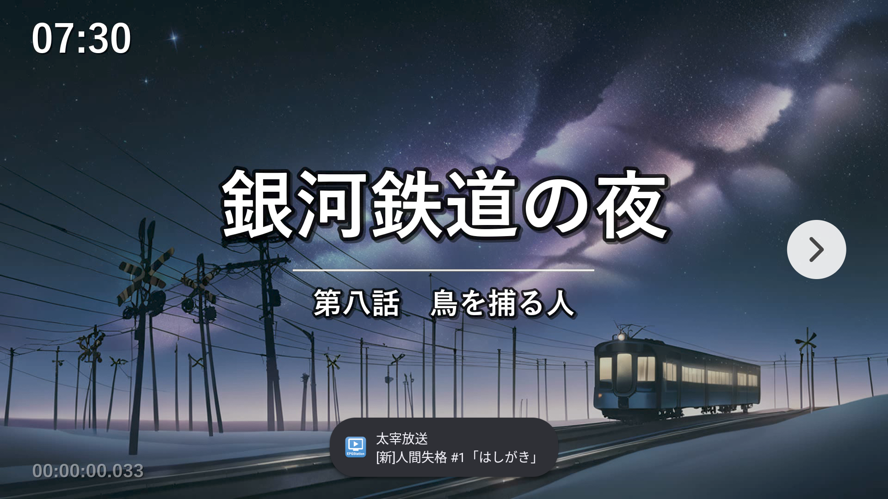
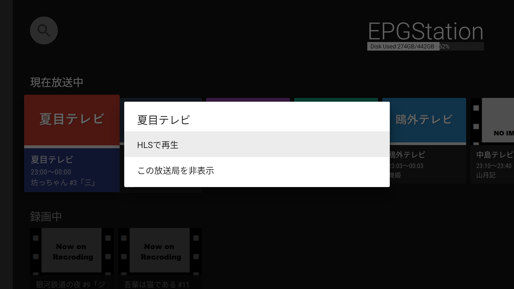
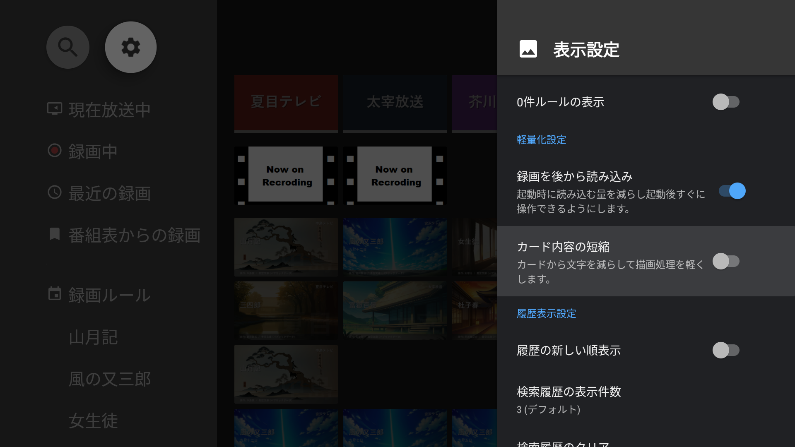

## 新機能

### ライブ視聴：視聴中に左右キーでチャンネルを変えられるようになりました

ライブ視聴の再生画面で ← → を押すとチャンネルを変えることができるようになりました。

### ライブ視聴：放送していないサブチャンネルが表示されないようになりました

- 番組情報がないサブチャンネルは、「現在放送中」の行に並ばなくなりました。

### 任意のチャンネルを隠せるようになりました

チャンネルのカードで決定を長押しし、「この放送局を非表示」を選ぶと、その局が「現在放送中」の行から消えます。隠した局は、設定 → 表示設定 → **非表示の放送局** から戻せます。

Thanks to @tsukasa1014 's contributions

### 初期ロードが軽くなりました

- 起動時にすべての番組を読み込まないように変更したので起動が軽くなりました。設定 → 表示設定 → 録画を後から読み込み で元に戻せます。

- 古めのAndroid TV (Android 7.1 / Fire OS 6 以前) ではカードの文字を減らしてスクロールが軽くなるようにしました。設定 → 表示設定 → カード内容の短縮 で元に戻せます。

Thanks to @tsukasa1014 's contributions

## 不具合修正

- Fire TV Stick など一部の機種でフォントの違いにより再生画面の操作パネルに出る番組名の上端が欠けていた問題を修正しました。

## ShortCode for Downloader by AFTVnews
7253346